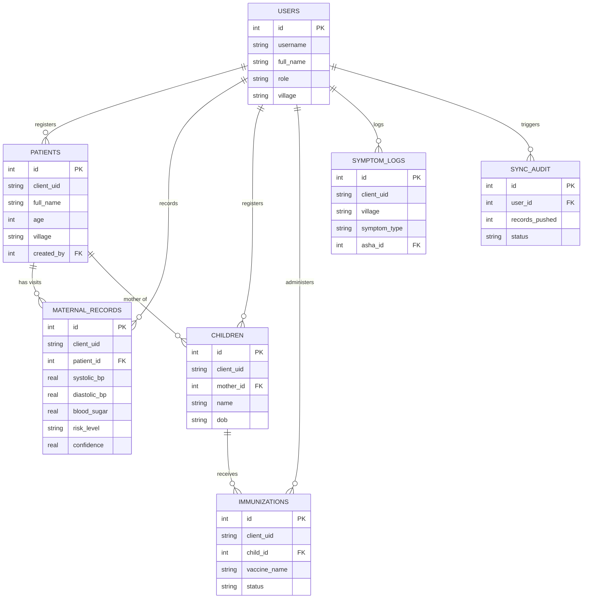

# MediConnect — System Architecture & Implementation Truth

> **System Definition**: MediConnect is a predictive EHR companion for Accredited Social Health Activists (ASHA workers) in low-connectivity rural health jurisdictions. It provides offline-capable health record management, supervised machine learning for maternal risk triage, rule-based immunization tracking, and rolling-baseline symptom outbreak surveillance.

---

## 1. Implemented Technology Stack

The project codebase strictly utilizes the following technologies:

| Layer | Implemented Technology | Notes / Verification |
|---|---|---|
| **Backend Framework** | Python 3.10+, FastAPI, Uvicorn | `backend/main.py` |
| **Frontend UI** | HTML5, Vanilla CSS3, Vanilla JavaScript | `frontend/index.html`, `styles.css`, `app.js`, `i18n.js` |
| **Relational Database** | SQLite 3 (`mediconnect.db`) | 7 relational tables, foreign key constraints enabled |
| **Machine Learning** | scikit-learn (1.9.0), joblib (1.5.3), pandas, numpy | `ml/train_maternal_model.py`, `ml/maternal_risk_model.joblib` |
| **Excel Analytics Engine** | xlrd (2.0.2), openpyxl | Reads `Child Immunization Dataset.xls` for district analytics |
| **Offline Mechanism** | Browser `localStorage` Offline Queue | Client-side queue for pending records during disconnection |
| **Synchronization** | HTTP REST Gateway (`POST /api/sync/push`) | Idempotent sync matching `client_uid` into SQLite |

> [!IMPORTANT]
> **Architecture & Technology Truth**: The current working prototype runs on **SQLite 3** (`mediconnect.db`). The system does **NOT** use XGBoost, PyOD, Isolation Forest, Streamlit, Flask, or Firebase. PostgreSQL is the target central database for multi-user server deployment, not the current standalone prototype database.

---

## 2. The Three Intelligent Decision-Support Modules

MediConnect incorporates three decision-support modules. **Only Module 1 uses a trained Machine Learning model.**

```
                               ┌────────────────────────────────────────────────────────┐
                               │       MediConnect Decision-Support Modules             │
                               └──────────────────────────┬─────────────────────────────┘
                                                          │
          ┌───────────────────────────────────────────────┼──────────────────────────────────────────────┐
          │                                               │                                              │
          ▼                                               ▼                                              ▼
┌───────────────────────────────────┐   ┌───────────────────────────────────┐   ┌───────────────────────────────────┐
│ Module 1: Maternal Risk           │   │ Module 2: Immunization Follow-Up  │   │ Module 3: Disease Outbreak Warning│
├───────────────────────────────────┤   ├───────────────────────────────────┤   ├───────────────────────────────────┤
│ • Genuine Supervised ML           │   │ • Rule-Based Engine (UIP)         │   │ • Statistical Anomaly Detection   │
│ • Model: RandomForestClassifier   │   │ • NOT Machine Learning            │   │ • NOT Machine Learning (No PyOD)  │
│ • 6 Clinical Features             │   │ • Evaluates Child Age vs Due Date │   │ • 7-day Cases vs 30-day Baseline  │
│ • Predicts: Low, Medium, High     │   │ • Status: Due, Overdue, Completed │   │ • Generates Early Advisory        │
│ • Evaluated by High-Risk Recall   │   │ • Generates Weekly VHSND Actions  │   │ • Non-clinical surveillance notice│
└───────────────────────────────────┘   └───────────────────────────────────┘   └───────────────────────────────────┘
```

### Module 1: Maternal Health Risk Prediction (Trained Supervised ML)
- **Nature**: Supervised Multiclass Classification.
- **Production Algorithm**: `RandomForestClassifier` (100 estimators, max depth 8, balanced class weights).
- **Model Artifact**: `ml/maternal_risk_model.joblib` with companion `ml/model_metadata.json`.
- **Dataset**: `Maternal Health Risk Data Set.csv` (1,014 clinical records).
- **Exact Six Input Features**:
  1. `Age` (Years)
  2. `SystolicBP` (mmHg)
  3. `DiastolicBP` (mmHg)
  4. `BS` (Blood glucose, mmol/L)
  5. `BodyTemp` (°F)
  6. `HeartRate` (BPM)
- **Target Variable**: `RiskLevel` (`Low Risk`, `Medium Risk`, `High Risk`).
- **Primary Evaluation Metric**: **High-Risk Recall** (prioritizes identification of high-risk cases).
- **Performance on Held-Out Test Set (203 samples)**:
  - High-Risk Recall: **92.73%** (51 of 55 actual High Risk cases identified)
  - High-Risk Precision: **96.23%**
  - High-Risk F1-Score: **94.44%**
  - Macro Recall: **80.13%**
  - Accuracy: **79.31%**
- **Clinical Disclaimer**: *"Decision-support prediction only. This is not a medical diagnosis."*

### Module 2: Child Immunization Follow-Up (Rule-Based UIP Schedule)
- **Nature**: Deterministic rule-based schedule matching engine based on India's Universal Immunization Programme (UIP).
- **Implementation**: `backend/services/child_followup.py`.
- **Mechanism**:
  - Compares the child's Date of Birth (`dob`) and current date against standard UIP vaccine intervals (Birth, 6w, 10w, 14w, 9-12m, 16-24m).
  - Assigns status: `COMPLETED`, `DUE`, `OVERDUE`, `FOLLOW_UP_REQUIRED`.
  - Computes urgency based on overdue duration:
    - `> 30 days overdue`: **HIGH** priority (immediate home visit).
    - `1–30 days overdue`: **MEDIUM** priority (visit within 3 days).
    - `Due within 7 days`: **DUE_SOON** (upcoming VHSND session).
- **Explicit Clarification**: This is **NOT** a trained ML default prediction model. It uses live SQLite records to generate field task lists.

### Module 3: Village Disease Outbreak Early Warning (Rolling Baseline Anomaly Detection)
- **Nature**: Statistical rolling-baseline anomaly detection.
- **Implementation**: `backend/services/outbreak_detector.py`.
- **Mechanism**:
  - Aggregates reported symptoms by village and symptom type (e.g., Fever, Diarrhea/Vomiting, Respiratory, Rash).
  - Calculates recent 7-day case counts ($C_{7d}$) and historical 30-day baseline ($B_{30d}$).
  - Normalizes the historical baseline to a 7-day equivalent rate: $B_{7d\_equiv} = (B_{30d} / 23) \times 7$.
  - Flags an anomaly if: $(C_{7d} / \max(1, B_{7d\_equiv}) \ge 2.5 \text{ and } C_{7d} \ge 4) \text{ or } (C_{7d} \ge 5)$.
- **Explicit Clarification**: This is **NOT** Isolation Forest, PyOD, or an ML model. It is an algorithmic epidemiological signal. It provides early advisory alerts and does **NOT** confirm a clinical or laboratory outbreak.

---

## 3. Database Truth (SQLite Schema)

The database `mediconnect.db` contains exactly **7 tables**:



### Table Definitions:
1. **`users`**: Field authentication for ASHA workers and supervisors (`id`, `username`, `full_name`, `role`, `village`, `password_hash`, `salt`).
2. **`patients`**: Pregnant women and mothers (`id`, `client_uid`, `full_name`, `age`, `village`, `rch_id`, `lmp_date`, `edd_date`, `created_by`).
3. **`maternal_records`**: ANC clinical visits with recorded measurements and ML prediction results (`id`, `client_uid`, `patient_id`, `age`, `systolic_bp`, `diastolic_bp`, `blood_sugar`, `body_temp`, `heart_rate`, `risk_level`, `confidence`, `model_version`, `recorded_by`).
4. **`children`**: Registered children (`id`, `client_uid`, `mother_id`, `name`, `gender`, `dob`, `birth_weight`, `village`, `created_by`).
5. **`immunizations`**: Child vaccination tracking (`id`, `client_uid`, `child_id`, `vaccine_name`, `dose_number`, `due_date`, `given_date`, `status`, `administered_by`).
6. **`symptom_logs`**: Syndromic surveillance entries (`id`, `client_uid`, `village`, `person_name`, `age`, `gender`, `symptom_type`, `severity`, `onset_date`, `asha_id`).
7. **`sync_audit`**: Ledger of batch synchronizations (`id`, `user_id`, `client_device_id`, `records_pushed`, `sync_type`, `status`, `synced_at`).

---

## 4. Offline Architecture & Synchronization Mechanism

```
   ┌────────────────────────────────────────────────────────┐
   │                  ASHA Worker Browser                   │
   └───────────────────────────┬────────────────────────────┘
                               │
               Online / Local Server Reachable?
                               ├── YES ──► POST /api/maternal/predict (Local ML Inference)
                               │
                               └── NO (Disconnected from Server)
                                    │
                                    ▼
                     ┌───────────────────────────────┐
                     │ Browser localStorage Queue    │
                     │ (Pending Records & client_uid)│
                     └──────────────┬────────────────┘
                                    │ Network Restored
                                    ▼
                     ┌───────────────────────────────┐
                     │ POST /api/sync/push           │
                     └──────────────┬────────────────┘
                                    │
                     ┌──────────────▼────────────────┐
                     │ SQLite Idempotent Upsert      │
                     │ (Checks client_uid uniqueness)│
                     └──────────────┬────────────────┘
                                    │
                     ┌──────────────▼────────────────┐
                     │ Writes to sync_audit Table    │
                     └───────────────────────────────┘
```

1. **Local ML Inference Execution**:
   - The local FastAPI backend acts as the on-device inference server.
   - Calling `POST /api/maternal/predict` targets `localhost:8000` and does **not** require internet connectivity.
   - If the backend is stopped, the frontend displays an explicit service unavailable alert. It does **not** generate fake heuristic fallback predictions.

2. **Offline Data Queue**:
   - When offline, patient registrations, symptom logs, and immunization updates are stored in `localStorage` under `mc_offline_queue`.
   - Each record is generated with a unique client identifier (`client_uid`, e.g., `OFFLINE-PAT-1727712345678`).

3. **Synchronization Gateway (`POST /api/sync/push`)**:
   - When network connectivity is re-established, the client batches pending records and pushes them to `/api/sync/push`.
   - The server verifies each `client_uid` against SQLite to prevent duplicates (idempotency).
   - A permanent log of the sync batch is written to `sync_audit`.

---

## 5. Model Selection & Retraining Pipeline

The maternal risk ML model is trained via `ml/train_maternal_model.py`:
1. **Dataset Preprocessing**: Loads `Maternal Health Risk Data Set.csv` (1,014 records), normalizes target classes to `Low Risk`, `Medium Risk`, `High Risk`.
2. **Stratified Split**: 80% Train (811 records), 20% Held-Out Test (203 records) with `random_state=42`.
3. **5-Fold Stratified Cross-Validation**: Evaluates three candidate algorithms:
   - `GradientBoostingClassifier`
   - `RandomForestClassifier`
   - `LogisticRegression`
4. **Dynamic Selection Hierarchy**:
   1. High-Risk Recall (Primary)
   2. Macro Recall
   3. Macro F1
   4. Macro Precision
   5. Accuracy
5. **Selection Result**: `RandomForestClassifier` won dynamically based on superior CV High-Risk Recall (**85.69%** vs 84.29% for GradientBoosting).
6. **Artifact Storage**: Serialized to `ml/maternal_risk_model.joblib` using `scikit-learn 1.9.0`.
7. **Metadata Storage**: `ml/model_metadata.json` stores all CV metrics, test metrics, confusion matrix, and feature importances.
